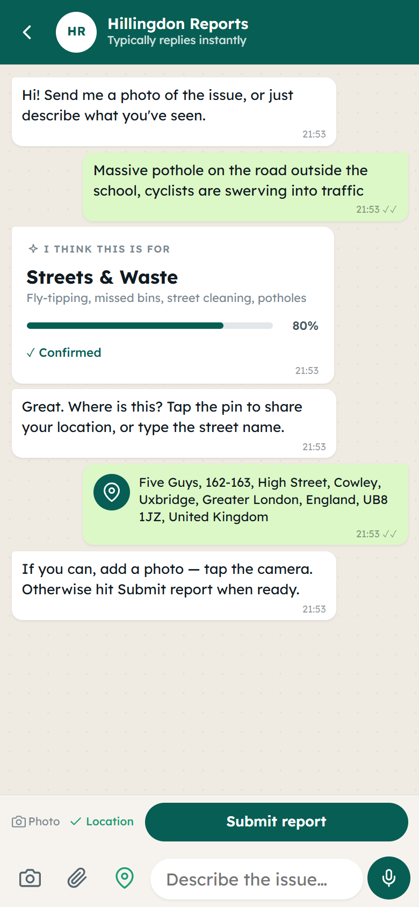
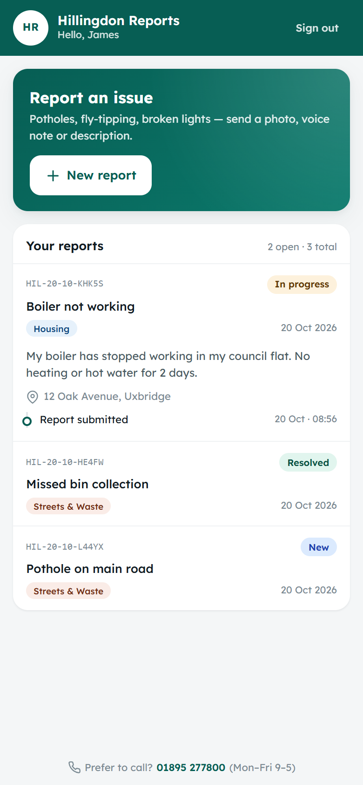
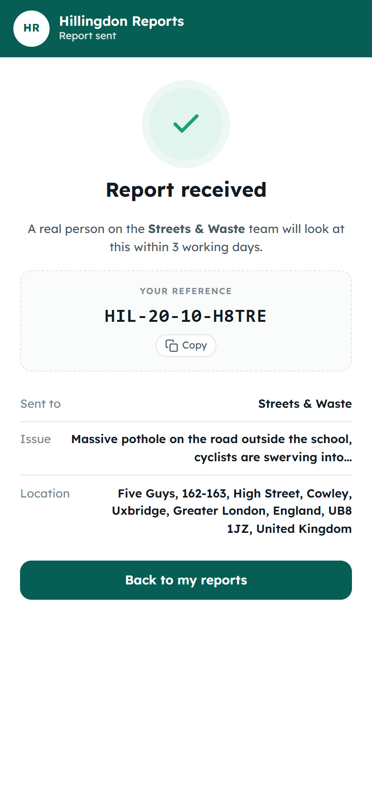
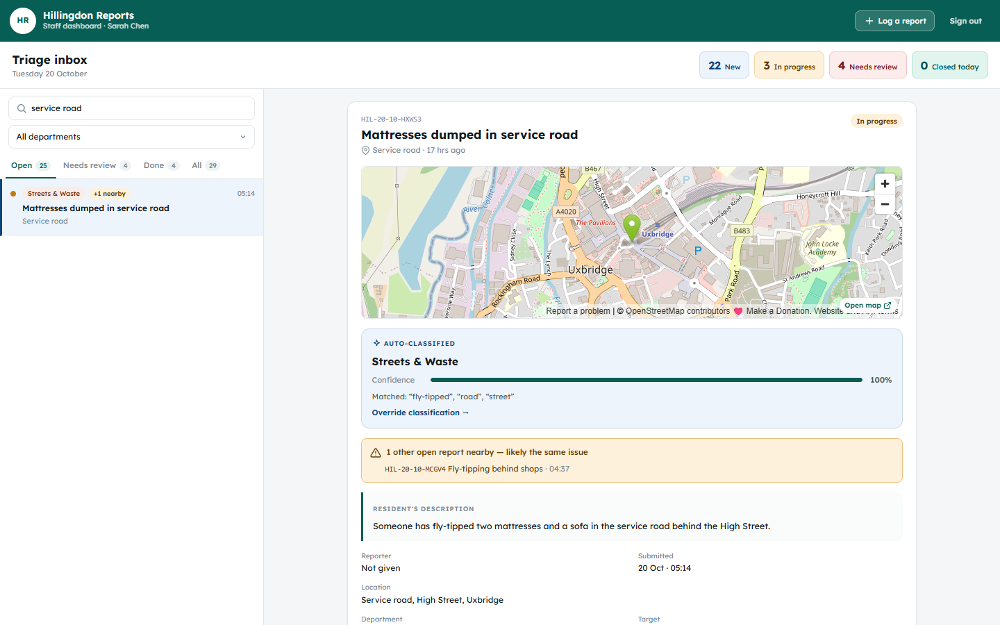

# Hillingdon ReportHub

**Report a pothole or a fly-tip in about 20 seconds.** Residents send a photo,
voice note or a quick message through a chat-style app. The system works out
which council team should handle it, and staff get a triage inbox with the
photo, a map, duplicate detection and an audit trail.

> Built at the **Hillingdon × Brunel Hackathon 2026** (April 2026) by a team of
> four, and presented to judges from Hillingdon Council, Microsoft, Brunel
> University London and ICS.AI. **Recognised by Microsoft.**

<p>
  
  
  
</p>


---

## The problem

Council reporting forms ask residents to pick the right department from a long
list before they can describe anything. People guess wrong, give up, or phone
in. Reports then land in the wrong queue and get passed between teams.

## What we built

**For residents**, the app is a chat they already know how to use:

- **Photo, voice or text.** Voice notes are transcribed (Deepgram) and shown back for confirmation before sending.
- **Instant routing.** As soon as there's enough detail, the bot shows which team the report will go to and how confident it is. The resident can confirm it or say "not quite".
- **Guided, not interrogated.** The bot asks only for what the street teams need: where it is (one-tap GPS, reverse-geocoded to an address) and a photo.
- **Reference number and tracking.** Each report gets a reference like `HIL-20-10-K7P2M`, and residents can follow it from *New* through *In progress* to *Resolved*.

**For council staff**, there's a triage inbox:

- **Auto-classification** into 8 departments, with confidence and the keywords it matched. Low-confidence reports go to a *Needs review* queue so a person makes the call.
- **Duplicate detection.** Open reports about the same thing within 150 m of each other are grouped ("+1 nearby"), so five fly-tipping reports become one job.
- **Urgency flags.** Reports mentioning a risk to people (a fallen tree on the pavement, cyclists swerving, safeguarding) float to the top.
- **Photo and map for every report**, plus one-click status changes, reassignment and a full audit log.
- **Live stats**, with search and filtering by department or status.

## Architecture

```
 Resident / staff (web or Android app via Capacitor)
          │
          ▼
 nginx :9443 ── serves the Preact SPA (static, cached, gzipped)
          │
          └── /api/* ──► FastAPI (uvicorn) ──► PostgreSQL
                              │
                              ├─ rules classifier (keyword weights + confidence margin)
                              ├─ Deepgram (voice → text, optional)
                              └─ llm.py stubs (hook for an LLM fallback / image analysis)
```

| Layer    | Tech |
|----------|------|
| Frontend | Preact, Vite, wouter, vanilla CSS with design tokens |
| Mobile   | Capacitor (Android) with native camera |
| Backend  | Python, FastAPI, SQLAlchemy, Pydantic, JWT auth (bcrypt) |
| Data     | PostgreSQL in production, SQLite locally |
| Infra    | Docker (one container: nginx and uvicorn), docker compose |
| Design   | Figma |

**How classification works:** each department has keywords weighted 1–3, and
they match whole words only, so "parent" doesn't count as "rent". The
highest-scoring department wins. Confidence is `(top score + margin over
second place) / 10`, so a close call between two teams scores lower even when
both match strongly. Anything under 0.4 goes to General Enquiries for a human
to route. The same algorithm runs in the browser (for the live suggestion in
the chat) and on the server (as the source of truth).

## Running it

### 1. Demo mode: no backend needed

```sh
cd frontend
npm install
npm run dev            # http://localhost:5173
```

Reports are stored in the browser and classified client-side, with 28 seeded
demo reports. Sign in with one of the demo accounts on the login screen.
Voice notes need the full stack.

### 2. Full stack, locally

```sh
# backend: http://localhost:8000, API docs at /api/docs
cd backend
python -m venv .venv && . .venv/bin/activate      # Windows: .venv\Scripts\activate
pip install -r requirements.txt
SEED_DEMO_REPORTS=1 python seed.py               # PowerShell: $env:SEED_DEMO_REPORTS=1; python seed.py
uvicorn app.main:app --reload --port 8000

# frontend: proxies /api to :8000
cd frontend
VITE_USE_BACKEND=true npm run dev                 # PowerShell: $env:VITE_USE_BACKEND="true"; npm run dev
```

### 3. Docker (production-like)

```sh
SECRET_KEY=$(openssl rand -hex 32) docker compose up --build
# → http://localhost:9443
```

| Variable | Purpose |
|----------|---------|
| `SECRET_KEY` | JWT signing key. **Required in production.** |
| `DEEPGRAM_KEY` | Enables voice-note transcription |
| `SEED_DEMO_REPORTS` | `1` loads the demo reports into an empty database (on by default in compose) |
| `CORS_ORIGINS` | Comma-separated allowed origins (default `*`) |

### Tests

```sh
cd backend
pip install pytest
python -m pytest tests
```

These cover the classifier (whole-word matching, plurals, routing the brief's
examples), auth, input validation, residents only seeing their own reports, and
the full status/reassign flow.

### Demo accounts

| Role     | Email                     | Password   |
|----------|---------------------------|------------|
| Resident | `fakeemail@gmail.com`     | `password` |
| Staff    | `admin@hillingdon.gov.uk` | `admin`    |

## Project layout

```
backend/
  app/
    classifier.py     rules engine (mirrors frontend/src/data/rules.js)
    deps.py           auth dependencies (current_user, require_admin)
    routers/          auth, reports, transcribe, chat
  seed.py             users + optional demo reports
  tests/
frontend/
  src/
    api.js            one API surface, real backend or localStorage mock
    pages/            LoginScreen, ResidentForm (chat), StaffDashboard
    components/       Header, Icon
    lib/              classifier, duplicate/urgency helpers, formatting, image resize
  android/            Capacitor project
nginx/default.conf
```

## Post-hackathon improvements

After the event I went back over the codebase to polish it and fix what we'd
rushed:

- **Design pass.** Rebuilt the stylesheet on design tokens, replaced emoji icons with an SVG set, added visible focus states, reduced-motion support, a phone-width layout on desktop, and a responsive staff dashboard.
- **Real data on the dashboard.** Stats, duplicate detection and urgency were mock-ups or random values in the demo. They're now computed from actual reports, and staff can change a report's status.
- **Photos and GPS are saved with each report**, with photos downscaled and EXIF-stripped on the device first. Previously they only appeared in the chat.
- **Classifier accuracy.** Matching now uses whole words, so "cabinet" no longer counts as a "bin" and "care home" no longer counts as a "car".
- **Backend performance.** Removed an N+1 query (one database query per report on every 5-second refresh), left photos out of list responses, added gzip, and paused polling when the tab is hidden.
- **Hardening.** Input validation, residents can't file reports under someone else's email, collision-resistant reference numbers, a correct CORS setup, an nginx upload limit that fits voice notes, and expired sessions handled cleanly.
- **Tests** for the API and classifier.

## Team

**Team InfinityV2**, Hillingdon × Brunel Hackathon 2026.

Built by G51DHU, Sanat, juliamuriasole-gif and Valorz1.

Shoutout to G51DHU, Sanat, juliamuriasole-gif real credit. :3
