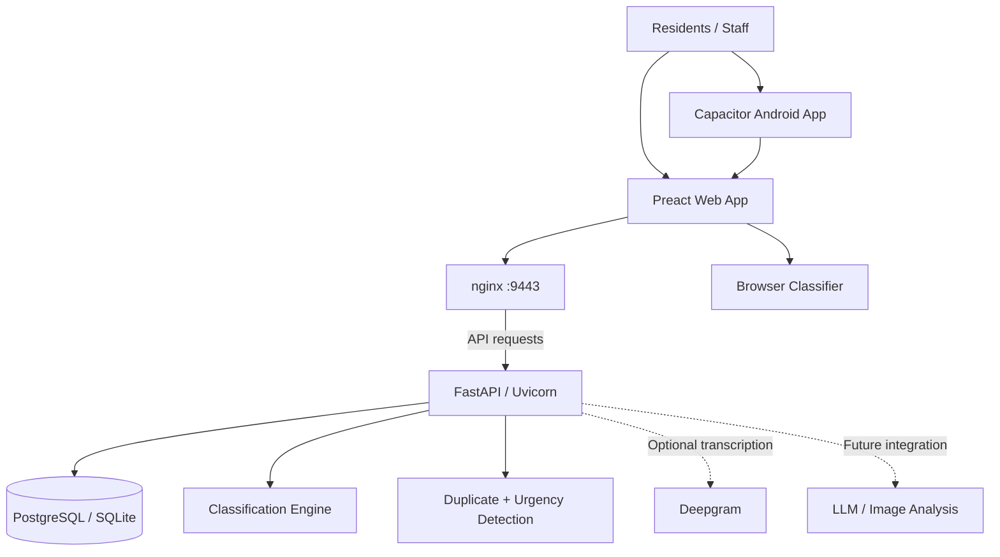

 
<div align="center">

# 🏙️ Hillingdon ReportHub

### Making local reporting simpler, smarter and more accessible.

**Report a pothole, fly-tipping or another neighbourhood issue in seconds.**

A conversational civic-tech application that helps residents report local problems while automatically suggesting the right council department to handle them.

Built for **Hillingdon Council's Core Challenge 04: Smart Triage and Routing** at the **Hillingdon × Brunel University Hackathon 2026**.


**🏆 Recognised by Microsoft for innovative design and creativity**

</div>

---

## 📸 Project Preview

### Resident reporting experience

A familiar chat-style interface where residents can describe problems naturally without navigating complicated council forms.

<p align="center">
  
  &nbsp;
  
  &nbsp;
  
</p>

### Council staff dashboard

A dedicated interface for council employees to review, classify, prioritise and manage incoming reports.

<p align="center">
  
</p>

---

## 🏆 The Hackathon Story

### My First Hackathon — Hillingdon × Brunel University Hackathon 2026

On **29 April 2026**, I participated in my first-ever hackathon, organised through a collaboration between Hillingdon Council and Brunel University of London.

It was one of the most exciting and challenging experiences I'd had as a Computer Science student.

We had a single day to understand a real-world problem, develop an idea, turn it into a functional prototype and present our solution to a panel of judges.

The fast-paced, competitive environment pushed me to think creatively, solve problems under pressure and step outside my comfort zone.

More importantly, it showed me how much a team can accomplish when everyone brings different skills and ideas to the table.

### 🎯 Our Challenge: Smart Triage and Routing

**Hillingdon Council — Core Challenge 04**

The challenge focused on improving how residents report local issues and how those reports are directed to the correct council teams.

Residents might report potholes, fly-tipping, damaged street infrastructure or housing concerns, but they don't always know which department should handle their issue.

Incorrect categorisation can create additional work for council staff and delay a report reaching the right team.

Our task was to develop a solution that could make this process easier for both residents and council employees.

### 💡 Our Solution

Working together as **Team Infinitev2**, we developed a reporting system designed to:

- Allow residents to describe issues using natural language.
- Automatically identify the most relevant council department.
- Reduce manual categorisation and incorrect routing.
- Make the reporting process simpler and more accessible.
- Support council staff with a clearer overview of incoming reports.

Instead of requiring residents to understand the council's internal departments, we wanted the application to do the initial routing work for them.

### 🛠️ Original Hackathon Technologies

The original one-day prototype involved:

| Technology | Role |
|---|---|
| Java | Application development |
| Preact | Lightweight user interface |
| Llama 3 | AI experimentation and report interpretation |
| Figma | UI/UX design and prototyping |
| APIs | Connecting application functionality |

The project has since been developed further using a Python/FastAPI backend and a deterministic classification engine. The original hackathon stack and the current application architecture are documented separately.

### 🏅 Microsoft Recognition

<blockquote>

**Team Infinitev2 received recognition from Microsoft for innovative design and creativity.**

</blockquote>

We also had the opportunity to present our solution to judges representing Hillingdon Council, Microsoft, Brunel University of London and ICS.AI.

For my first hackathon, receiving that recognition was a memorable achievement.

### What I Learned

This event taught me more than just how to build an application under time pressure.

It strengthened my ability to:

- Collaborate with developers and designers.
- Communicate ideas clearly during a technical project.
- Make practical decisions when time and resources are limited.
- Turn a real problem into a working software prototype.
- Present a technical solution to an external audience.

The experience also motivated me to continue developing the project after the event rather than leaving it as a one-day prototype.

A huge thank you to [London Borough of Hillingdon](https://www.linkedin.com/company/london-borough-of-hillingdon/), [Brunel University of London](https://www.linkedin.com/school/bruneluniversityoflondon/), [Microsoft](https://www.linkedin.com/company/microsoft/) and [ICS AI Ltd](https://www.linkedin.com/company/ics-ai-ltd/) for making the experience possible.

---

## 🌍 The Problem We're Solving

Reporting a local problem shouldn't require understanding how an entire council operates.

Traditional reporting forms can expect residents to select the correct service or department before describing an issue.

That creates several challenges:

- **Complex reporting:** Residents navigate forms and unfamiliar service categories.
- **Incorrect routing:** Reports can be assigned to unsuitable departments.
- **Repeated submissions:** Multiple people may report the same problem.
- **Limited visibility:** Residents may not know what happened after submitting a report.
- **Manual processing:** Council staff may need to review and reassign incoming requests.

These barriers can be particularly frustrating for people with limited digital confidence.

### Our Approach

**What if reporting a council issue felt as natural as sending a message?**

ReportHub replaces complicated form navigation with a guided conversation.

Residents explain the problem, provide a location and attach supporting information. The application handles initial classification and routing, while uncertain cases remain subject to human review.

---

## ✨ Key Features

### 👤 Resident Experience

**Conversational Reporting**

A chat-style interface where residents describe problems using everyday language.

**Photo, Voice and Text Support**

Residents can submit descriptions, photographs or recorded voice messages. Optional Deepgram transcription converts voice into reviewable text.

**Automatic Department Suggestions**

The classification engine suggests which council team should receive the report and provides confidence information.

**GPS Location Capture**

Device GPS and reverse geocoding help residents identify and confirm the location of an issue.

**Report References**

Every submitted report receives a unique reference number, such as:

`HIL-20-10-K7P2M`

**Status Tracking**

Residents can follow the progress of their reports:

`New → In Progress → Resolved`

### 🏛️ Council Staff Experience

**Centralised Dashboard**

View and manage reports in a searchable, filterable workspace.

**Eight-Department Classification**

Automatically categorise submissions using weighted keywords and confidence scoring.

**Human Review**

Uncertain reports are directed to General Enquiries rather than being assigned without sufficient evidence.

**Duplicate Detection**

Potential duplicate reports about nearby issues are identified within a 150-metre radius.

**Urgency Detection**

Descriptions containing possible public safety concerns can be flagged for prioritisation.

**Interactive Maps and Photos**

Staff can view report locations and supporting photographs.

**Report Management**

Update report statuses, reassign departments and review audit history.

**Operational Statistics**

View report totals, department breakdowns and status information using stored report data.

---

## 🧠 How the Classification Engine Works

The current version of ReportHub uses an explainable **rules-based classification engine**.

Unlike a general-purpose language model, the engine follows a deterministic set of weighted keywords.

Each department has associated keywords with weights ranging from 1 to 3.

### Classification Process

```text
Resident submits report
         |
         v
Analyse description
         |
         v
Match weighted keywords
         |
         v
Calculate department scores
         |
         v
Select highest-scoring department
         |
         v
Calculate confidence
         |
         +---- Confidence < 0.4
         |           |
         |           v
         |      Human review
         |
         +---- Confidence >= 0.4
                     |
                     v
              Suggest department
```

### Confidence Formula

```text
confidence = (top_score + (top_score - second_score)) / 10
```

The margin between the two highest-scoring departments affects the recommendation's confidence.

The engine also uses whole-word matching to reduce false positives.

For example:

- `parent` should not match `rent`.
- `cabinet` should not match `bin`.
- `care home` should not match `car`.

### Why Rules Instead of Only Using an LLM?

For a council reporting system, explainability matters.

A rules-based approach offers:

- Predictable classification.
- Low computational overhead.
- No requirement to send every report to an external AI service.
- Visibility into the keywords that influenced a decision.
- Straightforward automated testing.

The frontend uses a matching implementation to provide immediate suggestions, while the backend makes the authoritative routing decision.

LLM-assisted fallback and image analysis remain potential future enhancements.

---

## 🏗️ System Architecture

The current application uses a separate frontend, backend and persistence layer.



### Current Technology Stack

| Layer | Technologies |
|---|---|
| Frontend | Preact, Vite, wouter |
| Styling | Vanilla CSS, design tokens |
| Backend | Python, FastAPI, SQLAlchemy |
| Data Validation | Pydantic |
| Authentication | JWT, bcrypt |
| Database | PostgreSQL (production), SQLite (local) |
| Mobile | Capacitor for Android |
| Voice | Deepgram API |
| Infrastructure | Docker, nginx, Uvicorn |
| UI/UX Design | Figma |

---

## 🚀 Getting Started

There are three ways to run the application.

### 1. Frontend Demo — No Backend Required

**Requirements:** Node.js and npm.

From the repository root:

```bash
cd frontend
npm install
npm run dev
```

Open `http://localhost:5173`.

Demo mode includes 28 seeded reports, client-side classification and browser-based local storage.

Voice transcription requires the complete backend.

### 2. Full-Stack Development

#### Backend Setup

```bash
cd backend
python -m venv .venv
```

Activate the virtual environment.

**Windows PowerShell:**

```powershell
.\.venv\Scripts\Activate.ps1
```

**macOS / Linux:**

```bash
source .venv/bin/activate
```

Install dependencies:

```bash
pip install -r requirements.txt
```

To seed demonstration reports:

**Windows PowerShell:**

```powershell
$env:SEED_DEMO_REPORTS = "1"
python seed.py
```

**macOS / Linux:**

```bash
SEED_DEMO_REPORTS=1 python seed.py
```

Start the API:

```bash
uvicorn app.main:app --reload --port 8000
```

Backend: `http://localhost:8000`

API documentation: `http://localhost:8000/api/docs`

#### Frontend Setup

In a second terminal:

```bash
cd frontend
npm install
```

**Windows PowerShell:**

```powershell
$env:VITE_USE_BACKEND = "true"
npm run dev
```

**macOS / Linux:**

```bash
VITE_USE_BACKEND=true npm run dev
```

Open `http://localhost:5173`.

### 3. Docker Deployment

With Docker and Docker Compose installed, configure a secure `SECRET_KEY` and start the application.

Example for macOS / Linux:

```bash
SECRET_KEY=$(openssl rand -hex 32) docker compose up --build
```

Application: `http://localhost:9443`

### Environment Variables

| Variable | Description |
|---|---|
| `SECRET_KEY` | JWT signing key; required in production |
| `DEEPGRAM_KEY` | Optional voice transcription |
| `SEED_DEMO_REPORTS` | Loads sample reports into an empty database |
| `CORS_ORIGINS` | Permitted cross-origin request origins |

Use appropriately restricted settings and strong secrets for any deployment beyond local development.

---

## 🧪 Testing

Backend tests can be run with:

```bash
cd backend
pip install pytest
python -m pytest tests
```

The test suite covers:

- Classification and whole-word matching.
- Department routing examples.
- Authentication and authorisation.
- Input validation.
- Resident report-access restrictions.
- Report statuses and reassignment.

---

## 🔐 Demo Accounts

These credentials are for local demonstration only.

| Role | Email | Password |
|---|---|---|
| Resident | `fakeemail@gmail.com` | `password` |
| Council Staff | `admin@hillingdon.gov.uk` | `admin` |

Do not enable these seeded accounts on a public production deployment.

---

## 📁 Project Structure

```text
Hillingdon-ReportHub/
│
├── backend/
│   ├── app/
│   │   ├── classifier.py
│   │   ├── deps.py
│   │   ├── routers/
│   │   └── ...
│   ├── seed.py
│   ├── tests/
│   └── requirements.txt
│
├── frontend/
│   ├── src/
│   │   ├── api.js
│   │   ├── pages/
│   │   ├── components/
│   │   ├── data/
│   │   └── lib/
│   ├── android/
│   └── package.json
│
├── docs/
│   └── screenshots/
│
├── nginx/
│   └── default.conf
│
├── docker-compose.yml
└── README.md
```

---

## 🔧 Post-Hackathon Engineering Improvements

The hackathon required us to build a functional prototype in a single day.

After the event, I continued working on the project independently to improve its design, reliability and maintainability.

### 🎨 Design and Accessibility

- Introduced reusable CSS design tokens.
- Replaced emoji icons with a consistent SVG icon set.
- Improved mobile and desktop layouts.
- Added visible keyboard focus states.
- Introduced reduced-motion support.
- Refined the staff dashboard.

### 🧠 Classification Accuracy

- Improved keyword matching using whole-word boundaries.
- Reduced accidental keyword matches.
- Refined confidence scoring and routing behaviour.

### 📊 Functional Dashboard

- Replaced demonstration statistics with report-based calculations.
- Implemented duplicate and urgency detection using report data.
- Enabled staff to change statuses and reassign reports.

### ⚡ Performance Improvements

- Removed an N+1 database query during report refreshes.
- Reduced response sizes by excluding photographs from list endpoints.
- Enabled gzip compression.
- Paused polling when browser tabs are hidden.

### 🔒 Security and Data Handling

- Strengthened input validation.
- Restricted residents to accessing their own reports.
- Improved report reference generation.
- Corrected CORS configuration.
- Improved handling of expired authentication sessions.
- Added client-side image resizing and EXIF removal.
- Adjusted upload limits for voice messages.

### ✅ Automated Testing

Added tests covering core API behaviour, authentication, validation and classification.

**These improvements were an opportunity to apply what I'd learned and take the original hackathon idea further.**

---

## 🛣️ Future Roadmap

ReportHub is an evolving prototype, and there are several improvements worth exploring.

- [ ] Experiment with LLM-assisted classification for ambiguous reports.
- [ ] Explore image analysis for identifying common council issues.
- [ ] Improve duplicate detection using location and semantic similarity.
- [ ] Conduct accessibility and usability testing with residents.
- [ ] Investigate integration with council case-management systems.
- [ ] Expand security testing and deployment monitoring.
- [ ] Evaluate classification accuracy using a representative labelled dataset.

The goal is to develop a prototype that could eventually be evaluated for practical civic-service use.

---

## 👥 Meet Team Infinitev2

### Hillingdon × Brunel University Hackathon 2026

This project began as a collaborative effort by four team members:

| Team Member | GitHub |
|---|---|
| G51DHU | [@G51DHU](https://github.com/G51DHU) |
| Sanat | [@sanwagh](https://github.com/sanwagh)|
| juliamuriasole-gif | [@juliamuriasole-gif](https://github.com/juliamuriasole-gif) |
| Valorz1 | [@Valorz1](https://github.com/Valorz1) |

We worked together under the pressure of a one-day hackathon to develop and present a working solution to Hillingdon Council's Core Challenge 04.

**Microsoft recognised our team for innovative design and creativity.**

Special thanks to **G51DHU, Sanat and juliamuriasole-gif**. Everyone contributed to making the original hackathon project possible.

The application has continued to evolve after the event, with additional work focused on improving the codebase and user experience.

---

## 🙏 Acknowledgements

Thank you to the organisations involved in making the Hillingdon × Brunel University Hackathon 2026 possible:

- [London Borough of Hillingdon](https://www.linkedin.com/company/london-borough-of-hillingdon/)
- [Brunel University of London](https://www.linkedin.com/school/bruneluniversityoflondon/)
- [Microsoft](https://www.linkedin.com/company/microsoft/)
- [ICS AI Ltd](https://www.linkedin.com/company/ics-ai-ltd/)

The experience challenged my mindset, encouraged me to experiment with new technologies and gave me the confidence to tackle bigger software engineering problems.

---

## ❤️ Why This Project Matters

ReportHub is more than a hackathon project to me.

It began with an idea that public services should be easier to access, regardless of someone's technical confidence.

Many residents simply want to report a problem and know that it has reached the right place. They shouldn't have to understand how council departments are organised.

This project showed me how software, thoughtful interface design and responsible automation can work together to address a practical community problem.

It also marked an important milestone in my own development as a Computer Science student: my first hackathon, my first experience presenting this kind of solution to industry judges, and a project I wanted to keep improving afterwards.

<div align="center">

### Built in one day. Improved beyond the hackathon.

**Hillingdon ReportHub · Team Infinitev2 · 2026**

*Making public services easier to access, one report at a time.*

</div>
